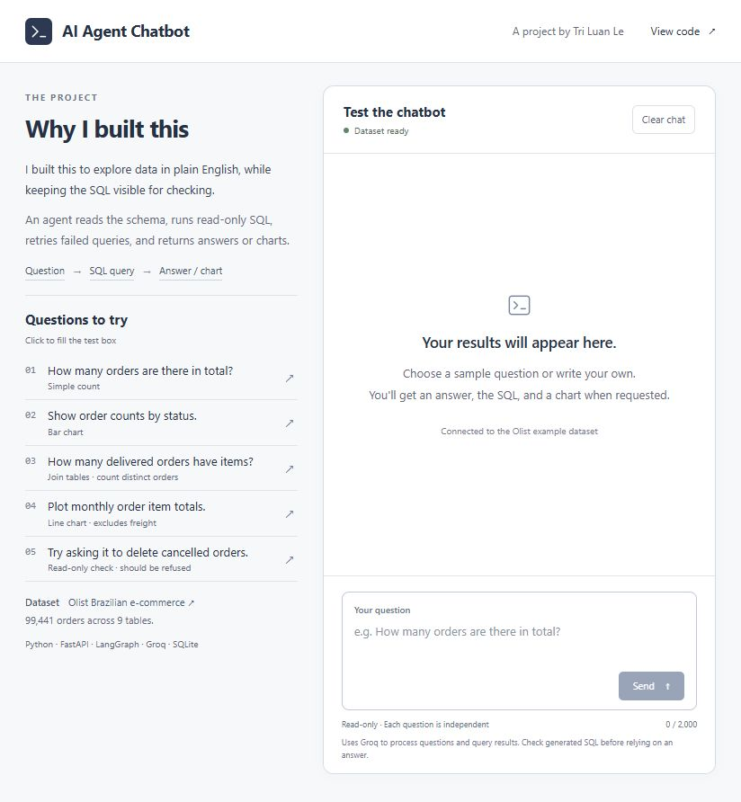
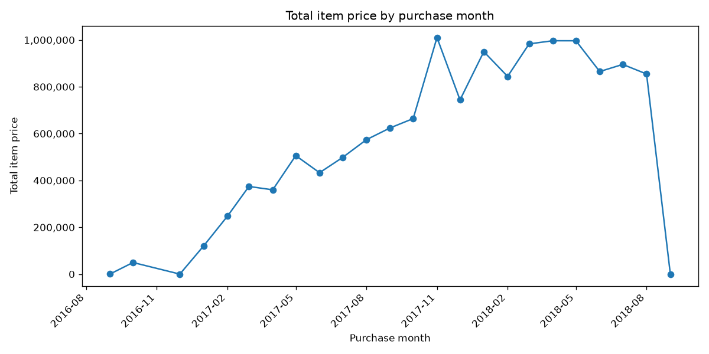
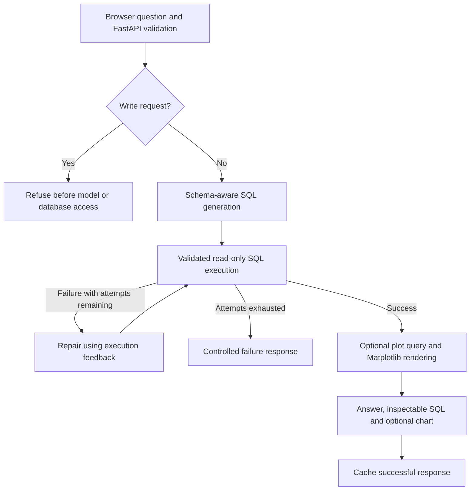
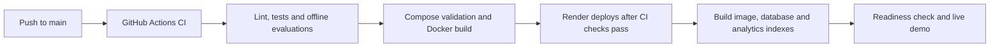

# AI Agent Chatbot

## [Try the Live Demo →](https://ai-agent-chatbot-demo.onrender.com/)

[](https://github.com/letriluan/AI-Agent-Chatbot/actions/workflows/ci.yml) [](https://github.com/letriluan/AI-Agent-Chatbot/actions/workflows/availability.yml)

A full-stack SQL analytics application that turns natural-language questions into **inspectable SQL, answers and charts**.

**Python · FastAPI · LangGraph · LangChain · Groq · SQLite · Matplotlib · JavaScript · Docker · GitHub Actions · Render**

[Project](#why-i-built-it) · [Design](#architecture-and-design) · [CI/CD](#cicd-and-deployment) · [Results](#evaluation-and-results) · [Run Locally](#quick-start) · [Engineering Notes](docs/ENGINEERING.md)

## Why I Built It

Relational databases contain useful information, but accessing it often requires SQL knowledge. I built this chatbot to let users ask questions in natural language and receive answers or charts directly from the database.

The goal is to make everyday data exploration easier for users who are unfamiliar with SQL, while allowing technical users to inspect the generated queries and verify the results.

The project connects a browser interface, an agent workflow, bounded database execution and chart rendering in one deployed application. The demo uses the [Olist Brazilian E-Commerce dataset](https://www.kaggle.com/datasets/olistbr/brazilian-ecommerce): **9 related tables and 99,441 orders**.

## Demo and Example Output

The interface places the project context and ten sample questions beside a working test panel. The desktop layout keeps both panels within one screen; smaller screens use project/demo tabs. Long answers scroll inside the test panel. Users can inspect and copy SQL, copy answers and download charts. Each question is independent; include the filters and context you need in that question.



**Example question:** “Plot monthly total order item prices as a line chart. Join order items to orders, group by purchase month in YYYY-MM format, include all statuses and exclude freight.”

<details>
<summary>View an actual monthly chart</summary>



The metric is the sum of item prices across all order statuses, excluding freight; it is not realised revenue. Missing months are not filled with artificial zero values.

</details>

## Architecture and Design

The fresh-question path below is simplified; cache shortcuts are described in the table that follows.



| Design choice | How it solves the problem |
| --- | --- |
| **FastAPI + browser UI** | Separates request validation and backend execution from the interface. Users can inspect the SQL behind each answer. |
| **LangGraph + Groq-hosted LLM** | Makes schema context, SQL generation and execution-feedback retries explicit. Main queries have at most three execution attempts. The tested model is `openai/gpt-oss-20b`, served through Groq. |
| **Read-only SQLite execution** | Validates SQL, opens read-only connections and uses a SQLite authorizer. Common write requests are refused before cache lookup or model calls. |
| **Three cache levels** | Reuses final answers/charts, question-to-SQL mappings and SQL results. Entries expire, database fingerprints invalidate stale data, and prompt changes affect answer/query cache identity. |
| **Bounded requests** | SQL has a **5-second limit per execution**, including plot queries. The public demo allows **5 questions per rolling minute per signed browser session**, with no daily or total quota. Request size, concurrent work and model output are also bounded. |
| **Build-time indexes** | Generic join/filter indexes reduce scans. The Render image additionally prepares Olist-specific month/order and order/price indexes for monthly aggregation. |
| **Matplotlib charts** | A separate read-only plot query supplies numeric data to bar/line renderers. Titles, axes and monthly dates are formatted in code. |
| **Request metrics** | Request IDs, cache source, attempt counts, stage timings and provider token metadata support diagnosis. Structured metrics logs omit questions, SQL and result rows. |

The 5-second SQL bound is not the total response timeout: generating SQL, repairing a query, summarising results and rendering a chart take additional time. A plotting query is generated separately from the main answer query; chart evaluations check its data independently.

[Engineering Notes](docs/ENGINEERING.md) explain cache behaviour, privacy checks, presentation rules and optional tracing.

## CI/CD and Deployment

GitHub Actions provides automated validation; Render is configured to deploy the connected `main` branch after CI checks pass. The dashboard setting was inspected on **5 November 2026**; `render.yaml` also declares `autoDeployTrigger: checksPass`. Blueprint automatic configuration sync is paused so configuration changes require a reviewed manual sync after CI succeeds.



- **CI:** dependency checks, Ruff, pytest, offline development/first-use references, Compose validation and a Docker build. It runs without provider credentials.
- **CD:** Render builds the repository's Docker image and deploys the web service, using `/ready` as its health check. SQLite is packaged into the image; no separate PostgreSQL service is required.
- **Secrets:** the Groq key and session-signing secret are supplied at runtime. Local `.env` files are excluded from Git and the Docker build context.

Render reads the GitHub check results before deploying; the CI workflow itself does not publish an image or call the Render deployment API. See [Render's CI integration rules](https://render.com/docs/deploys#integrating-with-ci). This setting has not been tested here by deliberately failing a deployment-branch commit.

The identifier and connection-recovery fixes reached Render in commit `5df7de9` on 5 November. Main CI passed at 05:23:08 UTC; Render's subsequent Auto-Deploy started at 05:23:11 UTC and became live at 05:24:39 UTC. An earlier Blueprint-triggered build was canceled and Blueprint Auto Sync disabled after it exposed a separate configuration-deployment path. Health, readiness, homepage, write refusal (zero model calls) and invalid-input checks passed on the new deployment.

See the [Render deployment guide](docs/DEPLOY_RENDER.md) for configuration and hosting limits.

**Availability:** UptimeRobot Free checks `/health` every **30 minutes**, with a **60-second timeout** and the expected JSON keyword. Automatic incident detection and recovery are verified. One controlled idle trial confirmed against Render lifecycle logs measured **32.85 seconds to healthy**, including an initial 503; warm health/readiness took **234 / 199 ms**. Free-service wake failures remain in the incident history; this is not a continuous uptime SLA. GitHub retains an on-demand health/readiness diagnostic. [Completion audit and monitoring evidence](docs/evaluations/project1-completion-2026-11-05/REPORT.md).

## Evaluation and Results

**Fixed-version five-run result, 5 November 2026:** **80/80 observations and 20/20 chart checks passed; all 16 cases passed every run (100%)**. Four naturally interrupted requests recovered within the shared two-retry limit. The incomplete earlier 22/23 attempt stopped on Free-tier quota and remains separate. [Complete fixed-version study](docs/evaluations/reliability-fixed-live-2026-11-05/REPORT.md) · [Preserved quota-restricted attempt](docs/evaluations/fixed-rerun-partial-2026-11-05/REPORT.md).

### Public-demo checks

After deploying the fixes on 5 November, two fresh hosted questions passed independent SQL-result checks (99,441 total orders and a chart of order statuses). They made five observed model calls; both cache repeats passed with zero model calls, including identical chart-image reuse. Health, readiness, homepage, write refusal and invalid-input checks also passed. Render's existing user-confirmed Free Groq credential was retained. [Fixed-version deployment smoke and chart review](docs/evaluations/render-fixed-deployment-2026-11-05/REPORT.md).

On **5 November 2026**, all **ten current demo checks passed** through the public Render API: nine SQL results matched independent Olist references and the write request was refused with zero model calls. The nine data questions were uncached and made 21 observed model calls; all three chart PNGs were visually inspected. Three cache repeats preserved SQL/images with zero model calls, and two invalid inputs returned HTTP 422. This is one known-question deployment check, not the five-run synthetic reliability study or transit evaluation. [Earlier full-suite report, raw results and chart review](docs/evaluations/render-live-2026-11-05/REPORT.md).

On **18 October 2026**, the original five sample questions were tested against the Render `/ask` endpoint after deploying the 5-second SQL configuration. The first four requests used no cached answers and succeeded on their first SQL attempt. Results were compared with reference queries over the source dataset, and both chart images were visually inspected.

| Sample | Verified result | Observed total time |
| --- | --- | --- |
| Total orders | **99,441** | 3.05 s |
| Orders by status | Correct counts across eight statuses and a bar chart | 5.15 s |
| Distinct delivered orders with items | **96,478**, counting each order once | 3.26 s |
| Monthly item-price totals | **24 months**, reference totals and a line chart | 7.83 s |
| Delete cancelled orders | Explicit refusal, empty SQL and **zero model calls** | 0.34 s |

These are single-run end-to-end observations, including network/provider work, not performance guarantees or a load test. The browser was also checked for chart rendering and cached-response reuse. [Archived public-demo results](docs/evaluations/render-demo-2026-10-18.json).

The five added prompts (06–10) were also verified against the live API and source-data references before the UI release: customer-state rankings, delivered-order percentage, payment-type counts/chart, product-category rankings and average item price. All succeeded on their first SQL attempt. [Added-sample results](docs/evaluations/added-samples-2026-10-18.json).

### Regression and earlier fixture evaluations

| Check | Evidence | Scope |
| --- | --- | --- |
| Earlier automated regressions | **161 passed** locally on Windows; Linux GitHub CI passed | Historical baseline before the November evaluation additions |
| Earlier development SQL suite | **30/30** strict matches | Questions used during prompt development |
| Earlier new-question first-use suite | **16/16** main SQL matches | Separate synthetic fixture; 12 SQL-only and four chart requests |
| First-use chart checks | **4/4 passed** | Plot-query rows, renderer inputs, chart type, labels, PNG output and cached-image reuse |

Strict SQL matching compares returned values, column count, duplicates and required ordering, rather than SQL wording. The first-use questions were evaluated with frozen prompts before using them as regression cases; they are no longer unseen. These small suites do not establish correctness on arbitrary schemas or factuality of every generated sentence.

[First-use protocol and report](docs/HOLDOUT_EVALUATION.md) · [Development results and validation history](docs/VALIDATION.md)

### November evaluation additions

- The **full fixed-version transit rerun passed 24/24 SQL and 4/4 chart checks**, including the corrected `S4` → `R2` lookup on its first SQL attempt. All 24 cached repeats used zero model calls. Numeric support was **16/17 scored answers (94.1%)**, one question-context flag reviewed manually and seven unscored. Known list-price subtotal **USD 0.005380875** covers 23/24 questions; one recovered request has incomplete usage. This is synthetic regression data, and the original 23/24 first-use failure remains preserved. [Complete transit rerun](docs/evaluations/transit-fixed-live-2026-11-05/REPORT.md).

- The **fixed-version five-run study passed 80/80 observations**, with **16/16 cases correct in every run and 20/20 chart checks**. All 80 cached repeats used zero model calls. Numeric support was **71/75 scored answers (94.7%)**, four question-date context flags reviewed manually, and five unscored answers. Known list-price estimate **USD 0.019544175** covers **76/80** questions; recovered requests with incomplete usage remain unknown, so no full mean or measured bill is claimed. [Full fixed-version report](docs/evaluations/reliability-fixed-live-2026-11-05/REPORT.md).

- **314 automated tests passed** locally on Windows/Python 3.12, including identifier grounding, bounded connection recovery and free-tier stop/resume controls. Lint, dependency compatibility and Compose configuration checks also passed. The merged commit also passed GitHub CI, including the Linux Docker build, and deployed to Render. [Latest fix validation](docs/evaluations/lookup-connection-followup-2026-11-05/REPORT.md) · [Initial offline verification](docs/evaluations/project1-offline-verification-2026-11-05.json).
- The **original pre-fix baseline** of five fresh-cache regression runs collected **80 observations**: **77 returned SQL results matched**, while three requests failed with `APIConnectionError`. **13/16 questions passed in every run (81.25%)**; chart cases succeeded in **18/20** observations, with two connection failures. Every returned SQL result matched; failed requests remain in the denominator. These are 16 exposed questions repeated five times, not 80 unseen questions. [Repeated-run report and raw evidence](docs/evaluations/reliability-live-2026-11-05/REPORT.md).
- A first live run on **24 synthetic transit questions** achieved **23/24 strict SQL matches and 4/4 chart checks**, with all four PNGs visually inspected. One stop-code lookup incorrectly filtered the stop-name column; the failure is preserved. This uses an invented five-table star schema, not Adelaide Metro data or a general cross-domain benchmark. [First-live report and failure analysis](docs/evaluations/transit-first-live-2026-11-05/REPORT.md).
- A conservative numeric-support check compares answer numbers with executed SQL cells. Applied retrospectively to the archived October holdout, **14 answers have supported numbers, one is flagged and one has no numeric claims**. The flagged answer repeats dates supplied in the question but not returned by SQL. This is a review flag, not proof of a false statement; numeric support does not establish semantic factuality. [Retrospective report](docs/evaluations/numeric-support-archived-holdout-2026-11-05.json).
- The controlled idle trial confirmed actual shutdown/restart in Render logs and measured **32.85 s to healthy**, preserving an initial 503. UptimeRobot automatic detection and recovery are now verified at the user-selected 30-minute interval. [Completion audit](docs/evaluations/project1-completion-2026-11-05/REPORT.md) · [Confirmed cold-start study](docs/evaluations/render-fixed-deployment-2026-11-05/REPORT.md).
- Initial dated token-based cost estimates cover **24/24 transit questions and 77/80 holdout observations**. Missing usage on the three failed requests is not treated as zero, so no complete holdout mean is claimed. Estimates use standard list prices and do not represent measured charges. [Estimate record and coverage](docs/evaluations/cost-estimates-2026-11-05.json).
- A separate local follow-up corrected the stop-code lookup: **4/4 affected regressions and 8/8 new identifier/name cases passed**, with three chart PNGs visually reviewed. A controlled pre-network failure and one naturally observed transport failure both recovered after one application retry. Original benchmark failures remain preserved; this is a targeted follow-up, not a new five-run reliability study. These fixes deployed to Render in commit `5df7de9` on 5 November. [Follow-up evidence](docs/evaluations/lookup-connection-followup-2026-11-05/REPORT.md).

[Protocol, commands and remaining work](docs/PROJECT1_EVALUATION.md)

### What Changed After Failures

Earlier checks exposed unnecessary output columns, integer division and unsupported currency labels. Fixes combined clearer query instructions with deterministic presentation rules. On Render, distinct-order joins and monthly aggregations also exceeded the earlier 2-second SQL bound; build-time indexes improved those query plans. The current SQL limit is 5 seconds, and timeout failures now explain the execution limit instead of blaming the question's wording. See the [deployment notes](docs/DEPLOY_RENDER.md#monthly-chart-performance-correction) for constrained-container measurements.

## Quick Start

Use the [hosted demo](https://ai-agent-chatbot-demo.onrender.com/) without setup, or run locally with Docker Compose and your own Groq key:

```bash
git clone https://github.com/letriluan/AI-Agent-Chatbot.git
cd AI-Agent-Chatbot
```

Copy `.env.example` to `.env` (`cp .env.example .env` on macOS/Linux, or `Copy-Item .env.example .env` in PowerShell). Set `GROQ_API_KEY` and a `GROQ_MODEL` available to your account. The tested model is `openai/gpt-oss-20b` **hosted by Groq**.

```bash
docker compose up --build
```

Open **http://127.0.0.1:8000** and ask: “How many orders are there in total?”

Compose first ingests the CSVs into a dataset volume, then starts the API as a non-root user with read-only data and a separate writable cache. Redis is not required. Unlike Render's packaged database, the Compose dataset volume uses the generic loader; to add the demo-specific monthly indexes after ingestion, run:

```bash
docker compose run --rm init-db python deploy/prepare_analytics.py --db db/app.sqlite
```

Stop the services with `docker compose down`. Volumes are retained; rerunning ingestion rebuilds the dataset and its generic indexes. Reapply the optional Olist-specific indexes after rebuilding that volume.

<details>
<summary>Local Python setup (Python 3.12)</summary>

```bash
python -m venv .venv
```

Activate with `.venv\Scripts\Activate.ps1` in PowerShell or `source .venv/bin/activate` on macOS/Linux. Copy `.env.example` to `.env` and configure Groq, then:

```bash
python -m pip install -r requirements.txt
python -m pip check
python load_db.py --data data --db db/app.sqlite
python deploy/prepare_analytics.py --db db/app.sqlite
python -m uvicorn src.server.app:app --port 8000
```

`GET /health` checks the process. `GET /ready` checks database tables without calling Groq. `POST /ask` accepts a non-blank question of up to 2,000 characters.

</details>

## Run Tests and Evaluations

```bash
python -m pip install -r requirements-dev.txt
ruff check .
pytest -q
python -m evals.run --mode offline --output reports/offline.json
python -m evals.holdout --mode offline --output reports/holdout-offline
python -m evals.holdout --suite transit --mode offline --output reports/transit-offline
```

Offline evaluations validate references without calling an LLM. Live evaluations make real Groq API calls and use isolated synthetic databases:

```bash
python -m evals.run --mode live --delay-seconds 12 --output reports/live.json
python -m evals.holdout --mode live --delay-seconds 15 --output reports/holdout-rerun
python -m evals.reliability --mode live --runs 5 --delay-seconds 15 --output reports/reliability-live
python -m evals.holdout --suite transit --mode live --delay-seconds 15 --output reports/transit-first-live
```

Live evaluations measure execution-result correctness, chart behaviour and literal numeric support separately. They do not establish complete narrative factuality. The repeated-run command requires a new output directory and refuses to pool different source/configuration fingerprints. Evaluation cost estimates use dated Groq standard rates only when complete token usage is recorded; they do not measure your bill. Generated reports under `reports/` are ignored by Git; selected evidence is archived under `docs/evaluations/`.

## Repository Guide

| Path | Purpose |
| --- | --- |
| `src/agent/` | Workflow, schema context, SQL controls, privacy, cache, charts and metrics |
| `src/server/`, `src/ui/` | FastAPI backend and browser interface |
| `load_db.py`, `data/` | Generic CSV ingestion and Olist source data |
| `deploy/`, `render.yaml` | Olist demo indexes, startup and Render configuration |
| `tests/`, `evals/` | Regressions, fixtures and evaluation runners |
| `docs/` | Engineering notes, deployment guide and archived results |
| `Dockerfile`, `compose.yaml`, `.github/workflows/ci.yml` | Packaging, local services and CI |

## Current Scope and Next Steps

This is a deployed project demo with a fixed example dataset. It does not provide authenticated users, tenant-level permissions, a business-data upload workflow or durable billing controls. Questions are independent, rather than a stateful multi-turn conversation. Provider-side schema and allowed query results can be sent to Groq.

Write-intent recognition and column-name privacy checks are conservative, incomplete controls; the SQLite executor independently enforces read-only access. Public limits use signed browser sessions rather than verified identities. Cache and quota state use ephemeral storage on Render, so they can reset after replacement or redeployment.

Next steps are to accumulate longer availability history and test on real Project 2 data when available. The identifier/recovery fixes are deployed and the new five-run study is complete. The eight identifier cases are now exposed regression cases; future prompt changes need another fresh evaluation set. End-user authentication, full narrative factuality and hosted LangSmith delivery remain outside the verified scope. Monetary estimates are distinct from measured billing. This deployment remains a portfolio demo.
