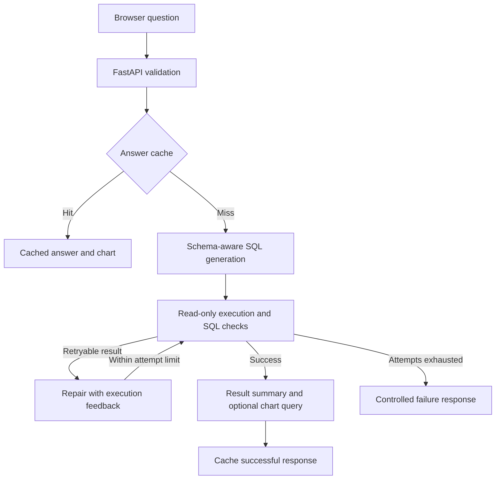

# AI-Agent-Chatbot

### A SQL analytics assistant that turns database questions into answers and charts.

Ask a question in the browser. The agent inspects the schema, generates and executes read-only SQL, attempts repairs when needed, and summarises the results. Chart requests produce bar or line plots from executed data.

**Python 3.12 · FastAPI · LangGraph · Groq · SQLite · Matplotlib · Docker**

[Quick Start](#quick-start) · [Example Output](#example-output) · [Architecture](#architecture) · [Evaluation](#evaluation) · [Engineering Notes](docs/ENGINEERING.md)

## Why I Built It

Natural-language analytics needs more than SQL generation: queries must respect the schema, execution needs boundaries, and answers need evidence. I built this project to connect those concerns in one inspectable application, using the [Olist Brazilian E-Commerce dataset](https://www.kaggle.com/datasets/olistbr/brazilian-ecommerce) as a working example.

The result is a local analytics prototype with a browser interface, a bounded agent workflow, persistent caching and reproducible SQL/chart evaluations.

## Example Output

**Question:** “Plot monthly total order item prices as a line chart. Join order items to orders, group by purchase month in YYYY-MM format, include all statuses and exclude freight.”


*Actual output from a live Olist chart check. The metric is the sum of item prices across all order statuses, excluding freight; it is not realised revenue. Available monthly records are plotted without filling missing months with zero.*

Other requests can count orders, compare categories, rank records or plot status distributions. The example database contains **9 tables and 99,441 orders**.

## What It Does

| Capability | Implementation |
| --- | --- |
| Ask questions about relational data | Schema and relationship context guide SQLite query generation |
| Recover from query failures | LangGraph supplies execution feedback for up to three main-query attempts |
| Bound database access | Read-only connections, SQLite authorization, timeouts and result limits |
| Visualise results | Bar/line charts with descriptive labels, calendar-aware month axes and numeric formatting |
| Reuse successful work | Answer, question-to-SQL and SQL-result caches with expiry and database fingerprints |
| Inspect backend behaviour | Request IDs, cache source, attempt counts, stage timings and provider token metadata |
| Verify behaviour | Regression tests, development references and a separate first-use SQL/chart evaluation |

## Quick Start

With Docker Compose installed, clone the repository and configure a local Groq key:

```bash
git clone https://github.com/letriluan/AI-Agent-Chatbot.git
cd AI-Agent-Chatbot
```

Copy `.env.example` to `.env` (`cp .env.example .env` on macOS/Linux, or `Copy-Item .env.example .env` in PowerShell). Set `GROQ_API_KEY` and a model available to your account. The tested model is `openai/gpt-oss-20b`, **served through Groq**.

```bash
docker compose up --build
```

Open **http://127.0.0.1:8000** and ask: “How many orders are there in total?”

Compose builds the Olist database before starting the API. The API runs as a non-root user with read-only data and a separate writable cache. For a virtual-environment workflow, see [Local Python Setup](#local-python-setup).

## Architecture



**Why this stack:** LangGraph makes retries explicit, FastAPI separates the backend from the browser, and SQLite keeps ingestion and evaluations easy to reproduce. Build-time indexes cover inferred join keys and low-cardinality text filters to reduce scans on small hosting instances. Charts use Matplotlib rather than model-drawn graphics. A separate plotting query is executed and checked against reference data during chart evaluation.

Prompt changes are included in answer/query cache identity. Coded filters such as `WA` can be summarised directly from results; common unsupported currency markers are filtered from generated answers. Details and implementation limits are documented in [Engineering Notes](docs/ENGINEERING.md).

## Evaluation

Verified locally on **18 October 2026**, with Python 3.12 and Groq-hosted `openai/gpt-oss-20b`.

| Evaluation | Result | Scope |
| --- | --- | --- |
| Automated regressions | **131 passed** on Windows; previous 130-case suite passed on Docker/Linux | Database controls, API, privacy rules, caching, retries, charts and reference cases |
| Development SQL suite | **30/30** strict matches | Questions used during prompt development |
| New-question first-use suite | **16/16** main SQL matches | 12 SQL-only requests and four chart requests, on a separate fixture with a frozen prompt |
| First-use chart checks | **4/4 passed** | Plot-query rows, actual renderer inputs, chart type, labels, nonblank PNG and image-cache reuse |
| Earlier chart checks | **4/4 passed** | Synthetic and Olist status/monthly scenarios |
| First-use cache repeats | **16/16 hits** | Second call per question, following an initially fresh cache |

Strict SQL matching compares returned values, column count, duplicates and required ordering—not SQL wording. New cases cover tied maxima, zero amounts, empty results, one-to-many joins, date boundaries, missing months and cumulative totals. All four new chart images were visually inspected.

The first-use suite was created after prompt development and evaluated without changing prompts in response to its outputs. It is now regression coverage, not a permanently unseen holdout. These small handcrafted suites do not establish accuracy on arbitrary databases or factuality of every generated sentence.

[First-use protocol and archived results](docs/HOLDOUT_EVALUATION.md) · [Development results and validation history](docs/VALIDATION.md)

### What I Learned from Failures

An earlier development run returned correct records but unnecessary columns, scoring **27/30**. Clarifying scalar values, ranked lists and filtered lists brought a later full run to **30/30**, with unchanged references. Other checks exposed integer-division errors, unsupported currency labels and location-code expansion. The fixes combine query instructions with deterministic presentation rules.

In the final 30-case development run, median cold latency was **1,232 ms**, versus **2.4 ms** for cached repeats; P95 cold latency was **2,541 ms**. These local measurements are not production guarantees. No repairs were triggered in that run, so live repair-success rate is unmeasured.

## Public Demo Deployment

A prepared [Render deployment guide](docs/DEPLOY_RENDER.md) uses SQLite baked into the Docker image, so no separate PostgreSQL service is required. Public-demo mode allows five questions per minute per signed browser session, with no total quota. It also adds a concurrency limit, a request-body cap and bounded model output. Secrets are supplied at runtime. The configuration has been tested locally; no hosted demo is claimed yet.

## Local Python Setup

Use Python 3.12 and an activated virtual environment:

```bash
python -m venv .venv
```

```powershell
# Windows PowerShell
.venv\Scripts\Activate.ps1
Copy-Item .env.example .env
```

```bash
# macOS / Linux
source .venv/bin/activate
cp .env.example .env
```

Set `GROQ_API_KEY` and choose a `GROQ_MODEL` available to your account. Then:

```bash
python -m pip install -r requirements.txt
python -m pip check
python load_db.py --data data --db db/app.sqlite
python -m uvicorn src.server.app:app --port 8000
```

Open **http://127.0.0.1:8000**. `GET /health` checks the process; `GET /ready` checks that the database has tables, without calling Groq. `POST /ask` accepts a non-blank question of up to 2,000 characters.

### Docker Lifecycle

```bash
docker compose up --build
```

Compose first prepares the database, then starts the API on **127.0.0.1:8000**. The API runs as a non-root user with a read-only data volume and a separate writable cache volume. Redis is not required by this application.

```bash
docker compose down
```

Volumes are retained. Re-run the ingestion service deliberately when changing the dataset. The image build explicitly copies application/data files and excludes local credentials and generated files.

## Tests and Evaluation

```bash
python -m pip install -r requirements-dev.txt
ruff check .
pytest -q
python -m evals.run --mode offline --output reports/offline.json
python -m evals.holdout --mode offline --output reports/holdout-offline
```

With valid provider credentials, run a live evaluation. This makes real API calls and can incur usage charges; pacing reduces the chance of rate limits:

```bash
python -m evals.run --mode live --delay-seconds 12 --output reports/live.json
python -m evals.holdout --mode live --delay-seconds 15 --output reports/holdout-rerun
```

Both modes use an isolated synthetic database, not your configured business database. Live mode measures execution-result correctness and repair outcomes, not exact SQL-string matching or automatic factuality of the final narrative. Generated reports under `reports/` are ignored by Git. The archived first-use report under `docs/evaluations/` is retained as evidence.

The CI workflow runs lint, tests, offline references, Compose configuration validation and a Docker build. It requires no provider secrets. It performs validation only, not deployment.

## Repository Guide

| Path | Purpose |
| --- | --- |
| `src/agent/` | Graph workflow, schema, query execution, privacy, cache, charts and metrics |
| `src/server/`, `src/ui/` | FastAPI backend and browser interface |
| `load_db.py`, `data/` | Olist CSV ingestion |
| `tests/` | Offline regressions |
| `evals/` | Development and first-use fixtures, cases and runners |
| `docs/` | Engineering notes, validation protocol and archived evidence |
| `Dockerfile`, `compose.yaml`, `.github/workflows/ci.yml` | Packaging and automated checks |

## Current Scope and Next Steps

This prototype has no authentication, per-user data permissions or durable billing controls. Demo-mode request limits are available for a controlled public demo; their quota state is ephemeral on Render Free. Follow the [deployment guide](docs/DEPLOY_RENDER.md) before publishing. The normal Compose setup remains bound to localhost. Privacy checks rely on column naming and do not replace a complete access policy; database schema and allowed query results can be sent to Groq.

Next steps are broader unseen-question evaluation, narrative factuality review, repeated-run reliability checks and a controlled deployment with access controls and monitoring. Hosted LangSmith delivery and monetary cost have not been verified. The GitHub Actions workflow runs offline checks without provider credentials.
