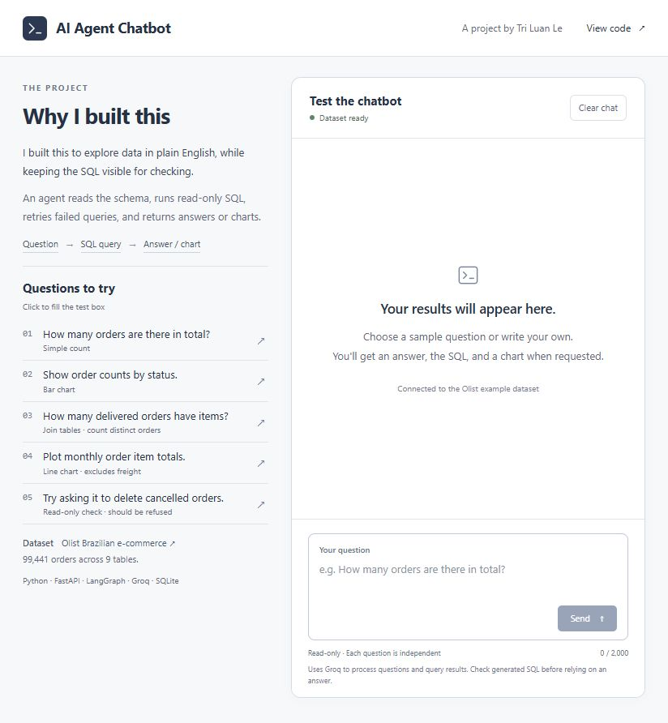
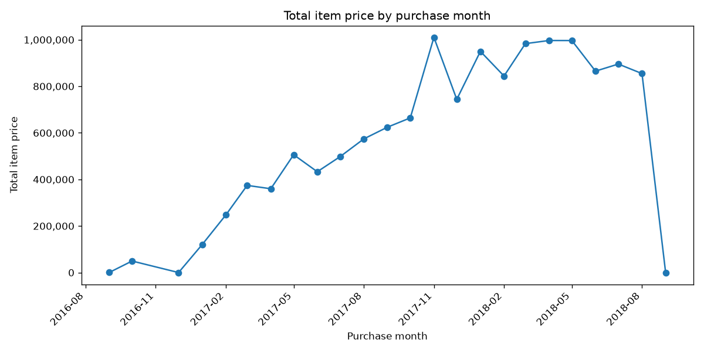
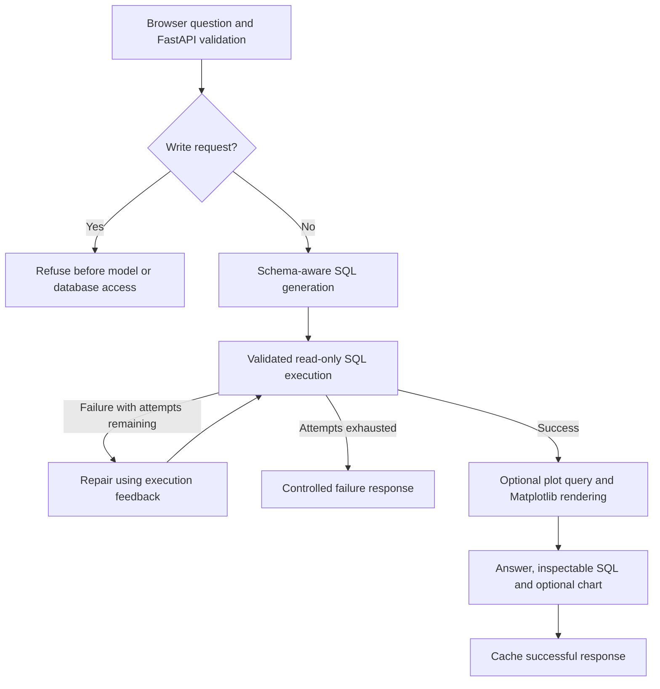
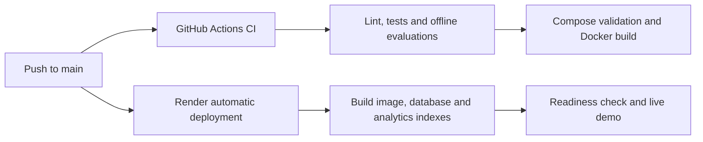

# AI Agent Chatbot

## [Try the Live Demo →](https://ai-agent-chatbot-demo.onrender.com/)

A full-stack SQL analytics application that turns natural-language questions into **inspectable SQL, answers and charts**.

**Python · FastAPI · LangGraph · LangChain · Groq · SQLite · Matplotlib · JavaScript · Docker · GitHub Actions · Render**

[Project](#why-i-built-it) · [Design](#architecture-and-design) · [CI/CD](#cicd-and-deployment) · [Results](#evaluation-and-results) · [Run Locally](#quick-start) · [Engineering Notes](docs/ENGINEERING.md)

## Why I Built It

Relational databases contain useful information, but accessing it often requires SQL knowledge. I built this chatbot to let users ask questions in natural language and receive answers or charts directly from the database.

The goal is to make everyday data exploration easier for users who are unfamiliar with SQL, while allowing technical users to inspect the generated queries and verify the results.

The project connects a browser interface, an agent workflow, bounded database execution and chart rendering in one deployed application. The demo uses the [Olist Brazilian E-Commerce dataset](https://www.kaggle.com/datasets/olistbr/brazilian-ecommerce): **9 related tables and 99,441 orders**.

## Demo and Example Output

The interface places the project context and five sample questions beside a working test panel. Users can inspect and copy SQL, copy answers and download charts. Each question is independent; include the filters and context you need in that question.



**Example question:** “Plot monthly total order item prices as a line chart. Join order items to orders, group by purchase month in YYYY-MM format, include all statuses and exclude freight.”

<details>
<summary>View an actual monthly chart</summary>



The metric is the sum of item prices across all order statuses, excluding freight; it is not realised revenue. Missing months are not filled with artificial zero values.

</details>

## Architecture and Design

The fresh-question path below is simplified; cache shortcuts are described in the table that follows.



| Design choice | How it solves the problem |
| --- | --- |
| **FastAPI + browser UI** | Separates request validation and backend execution from the interface. Users can inspect the SQL behind each answer. |
| **LangGraph + Groq-hosted LLM** | Makes schema context, SQL generation and execution-feedback retries explicit. Main queries have at most three execution attempts. The tested model is `openai/gpt-oss-20b`, served through Groq. |
| **Read-only SQLite execution** | Validates SQL, opens read-only connections and uses a SQLite authorizer. Common write requests are refused before cache lookup or model calls. |
| **Three cache levels** | Reuses final answers/charts, question-to-SQL mappings and SQL results. Entries expire, database fingerprints invalidate stale data, and prompt changes affect answer/query cache identity. |
| **Bounded requests** | SQL has a **5-second limit per execution**, including plot queries. The public demo allows **5 questions per rolling minute per signed browser session**, with no daily or total quota. Request size, concurrent work and model output are also bounded. |
| **Build-time indexes** | Generic join/filter indexes reduce scans. The Render image additionally prepares Olist-specific month/order and order/price indexes for monthly aggregation. |
| **Matplotlib charts** | A separate read-only plot query supplies numeric data to bar/line renderers. Titles, axes and monthly dates are formatted in code. |
| **Request metrics** | Request IDs, cache source, attempt counts, stage timings and provider token metadata support diagnosis. Structured metrics logs omit questions, SQL and result rows. |

The 5-second SQL bound is not the total response timeout: generating SQL, repairing a query, summarising results and rendering a chart take additional time. A plotting query is generated separately from the main answer query; chart evaluations check its data independently.

[Engineering Notes](docs/ENGINEERING.md) explain cache behaviour, privacy checks, presentation rules and optional tracing.

## CI/CD and Deployment

GitHub Actions provides automated validation; Render provides automatic delivery from the connected `main` branch.



- **CI:** dependency checks, Ruff, pytest, offline development/first-use references, Compose validation and a Docker build. It runs without provider credentials.
- **CD:** Render builds the repository's Docker image and deploys the web service, using `/ready` as its health check. SQLite is packaged into the image; no separate PostgreSQL service is required.
- **Secrets:** the Groq key and session-signing secret are supplied at runtime. Local `.env` files are excluded from Git and the Docker build context.

These are separate integrations: **Render deployment is not currently gated on a successful GitHub Actions run**. The CI workflow itself does not publish an image or deploy the service.

See the [Render deployment guide](docs/DEPLOY_RENDER.md) for configuration and hosting limits.

## Evaluation and Results

### Latest public-demo check

On **18 October 2026**, all five sample questions were tested against the Render `/ask` endpoint after deploying the 5-second SQL configuration. The first four requests used no cached answers and succeeded on their first SQL attempt. Results were compared with reference queries over the source dataset, and both chart images were visually inspected.

| Sample | Verified result | Observed total time |
| --- | --- | --- |
| Total orders | **99,441** | 3.05 s |
| Orders by status | Correct counts across eight statuses and a bar chart | 5.15 s |
| Distinct delivered orders with items | **96,478**, counting each order once | 3.26 s |
| Monthly item-price totals | **24 months**, reference totals and a line chart | 7.83 s |
| Delete cancelled orders | Explicit refusal, empty SQL and **zero model calls** | 0.34 s |

These are single-run end-to-end observations, including network/provider work, not performance guarantees or a load test. The browser was also checked for chart rendering and cached-response reuse. [Archived public-demo results](docs/evaluations/render-demo-2026-10-18.json).

### Regression and earlier fixture evaluations

| Check | Evidence | Scope |
| --- | --- | --- |
| Current automated regressions | **161 passed** locally on Windows; Linux GitHub CI passed | Database controls, API, privacy, caching, retries, charts and reference cases |
| Earlier development SQL suite | **30/30** strict matches | Questions used during prompt development |
| Earlier new-question first-use suite | **16/16** main SQL matches | Separate synthetic fixture; 12 SQL-only and four chart requests |
| First-use chart checks | **4/4 passed** | Plot-query rows, renderer inputs, chart type, labels, PNG output and cached-image reuse |

Strict SQL matching compares returned values, column count, duplicates and required ordering, rather than SQL wording. The first-use questions were evaluated with frozen prompts before using them as regression cases; they are no longer unseen. These small suites do not establish correctness on arbitrary schemas or factuality of every generated sentence.

[First-use protocol and report](docs/HOLDOUT_EVALUATION.md) · [Development results and validation history](docs/VALIDATION.md)

### What Changed After Failures

Earlier checks exposed unnecessary output columns, integer division and unsupported currency labels. Fixes combined clearer query instructions with deterministic presentation rules. On Render, distinct-order joins and monthly aggregations also exceeded the earlier 2-second SQL bound; build-time indexes improved those query plans. The current SQL limit is 5 seconds, and timeout failures now explain the execution limit instead of blaming the question's wording. See the [deployment notes](docs/DEPLOY_RENDER.md#monthly-chart-performance-correction) for constrained-container measurements.

## Quick Start

Use the [hosted demo](https://ai-agent-chatbot-demo.onrender.com/) without setup, or run locally with Docker Compose and your own Groq key:

```bash
git clone https://github.com/letriluan/AI-Agent-Chatbot.git
cd AI-Agent-Chatbot
```

Copy `.env.example` to `.env` (`cp .env.example .env` on macOS/Linux, or `Copy-Item .env.example .env` in PowerShell). Set `GROQ_API_KEY` and a `GROQ_MODEL` available to your account. The tested model is `openai/gpt-oss-20b` **hosted by Groq**.

```bash
docker compose up --build
```

Open **http://127.0.0.1:8000** and ask: “How many orders are there in total?”

Compose first ingests the CSVs into a dataset volume, then starts the API as a non-root user with read-only data and a separate writable cache. Redis is not required. Unlike Render's packaged database, the Compose dataset volume uses the generic loader; to add the demo-specific monthly indexes after ingestion, run:

```bash
docker compose run --rm init-db python deploy/prepare_analytics.py --db db/app.sqlite
```

Stop the services with `docker compose down`. Volumes are retained; rerunning ingestion rebuilds the dataset and its generic indexes. Reapply the optional Olist-specific indexes after rebuilding that volume.

<details>
<summary>Local Python setup (Python 3.12)</summary>

```bash
python -m venv .venv
```

Activate with `.venv\Scripts\Activate.ps1` in PowerShell or `source .venv/bin/activate` on macOS/Linux. Copy `.env.example` to `.env` and configure Groq, then:

```bash
python -m pip install -r requirements.txt
python -m pip check
python load_db.py --data data --db db/app.sqlite
python deploy/prepare_analytics.py --db db/app.sqlite
python -m uvicorn src.server.app:app --port 8000
```

`GET /health` checks the process. `GET /ready` checks database tables without calling Groq. `POST /ask` accepts a non-blank question of up to 2,000 characters.

</details>

## Run Tests and Evaluations

```bash
python -m pip install -r requirements-dev.txt
ruff check .
pytest -q
python -m evals.run --mode offline --output reports/offline.json
python -m evals.holdout --mode offline --output reports/holdout-offline
```

Offline evaluations validate references without calling an LLM. Live evaluations make real Groq API calls and use isolated synthetic databases:

```bash
python -m evals.run --mode live --delay-seconds 12 --output reports/live.json
python -m evals.holdout --mode live --delay-seconds 15 --output reports/holdout-rerun
```

Live evaluations measure execution-result correctness and chart behaviour; they do not automatically establish narrative factuality. Generated reports under `reports/` are ignored by Git; selected evidence is archived under `docs/evaluations/`.

## Repository Guide

| Path | Purpose |
| --- | --- |
| `src/agent/` | Workflow, schema context, SQL controls, privacy, cache, charts and metrics |
| `src/server/`, `src/ui/` | FastAPI backend and browser interface |
| `load_db.py`, `data/` | Generic CSV ingestion and Olist source data |
| `deploy/`, `render.yaml` | Olist demo indexes, startup and Render configuration |
| `tests/`, `evals/` | Regressions, fixtures and evaluation runners |
| `docs/` | Engineering notes, deployment guide and archived results |
| `Dockerfile`, `compose.yaml`, `.github/workflows/ci.yml` | Packaging, local services and CI |

## Current Scope and Next Steps

This is a deployed project demo with a fixed example dataset. It does not provide authenticated users, tenant-level permissions, a business-data upload workflow or durable billing controls. Questions are independent, rather than a stateful multi-turn conversation. Provider-side schema and allowed query results can be sent to Groq.

Write-intent recognition and column-name privacy checks are conservative, incomplete controls; the SQLite executor independently enforces read-only access. Public limits use signed browser sessions rather than verified identities. Cache and quota state use ephemeral storage on Render, so they can reset after replacement or redeployment.

Next steps include broader fresh-question evaluation, narrative factuality checks, repeated-run reliability measurement, authentication and monitoring. Hosted LangSmith delivery and monetary cost reporting remain unverified. Deployment should remain described as a demo, rather than a production-ready service.
