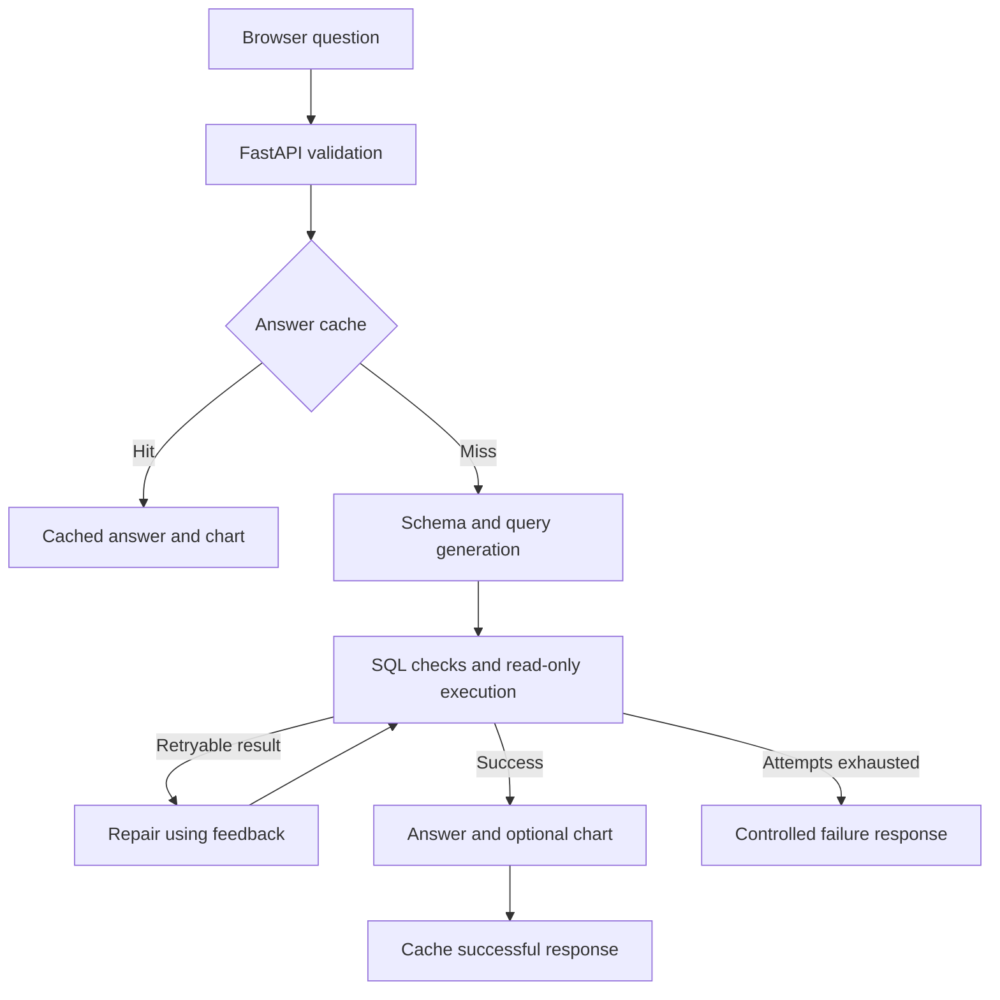

# Engineering Notes

## Methods and Architecture

**Design choices:** LangGraph makes the retry path explicit; SQLite keeps the demo and reference evaluations self-contained; FastAPI separates the backend from the browser UI. Groq is the configured LLM provider, with model selection kept in environment settings. These choices favour a small, inspectable application over additional gateway, vector-database or Redis services that this workflow does not require.



### Schema and repair

SQLite metadata supplies the table, column and relationship context. The main LangGraph path permits up to three query execution attempts, with previous SQL and execution feedback supplied to repair attempts. After exhaustion, a deterministic failure response is returned rather than asking the model to invent an answer from failed execution.

SQL prompts distinguish between scalar questions such as a maximum amount, ranked lists that need an identifier and ranking metric, and filtered lists that only need the requested identifiers. This reduces unnecessary output columns. Fractions use floating-point division to avoid SQLite integer truncation. These are prompt instructions, not a formal runtime guarantee of semantic correctness.

### Write-intent refusal

Common English and Vietnamese requests to change database records or structure are refused deterministically before graph construction, cache lookup, model calls or database access. The response has `ok=false`, empty SQL, no image and zero model calls. Requests are not silently translated into SELECT queries. This conservative phrase recogniser is not a complete natural-language policy engine; the database executor independently enforces read-only access. Regression cases include valid analytics and chart-editing requests to check false positives.

### Database controls

The agent opens an existing database with `mode=ro` and `query_only`. An authorizer rejects write operations, internal SQLite table reads and access to recognised personal-data columns, including attempts to alias those columns. A progress handler interrupts expensive queries; an outer `LIMIT` bounds returned rows even if the generated SQL contains its own limit.

Text-based checks and column-name privacy rules are intentionally conservative and incomplete. They do not replace a reviewed data-access policy or tenant-specific permissions.

### Caching and charts

Three cache levels store answers, question-to-SQL mappings and query results with expiry and database fingerprints. Question keys preserve punctuation and Unicode to avoid conflating inputs such as `1.5` and `15`. Prompt changes and the cache version are included in query/answer cache identity.

Successful answers can reuse their chart. When only a query mapping is available, plotting requests rebuild the visualisation. Failed query results are not persisted as successful answers. Matplotlib rendering is serialized within each process to avoid concurrent global plotting state.

### Grounded presentation

Coded filters supplied by the user (such as `WA`) are summarised directly from query results without expanding them into geographic names. Ordinary generated answers receive a conservative filter for common currency markers when no currency is supplied by the question or result data. This does not infer units, convert currencies or replace a complete grounding evaluation.

Charts use descriptive result-column labels and deterministic titles. Monthly series use a calendar axis with distinct month ticks; missing months are not silently zero-filled. Count axes use integer ticks, and large values use separators without inventing currency units.

### Observability

Responses include request IDs, cache source, attempts and metrics for total latency, graph-stage timings, LLM calls and token usage when returned by the provider. Structured local logs omit questions, SQL and result rows.

Optional LangSmith tracing uses LangGraph's existing tracing integration. Trace inputs/outputs are hidden by default. No remote dashboard or cost estimate is fabricated; hosted trace delivery requires valid credentials and explicit enablement.

## Optional Tracing

Set the following locally to enable LangSmith:

```dotenv
LANGCHAIN_TRACING_V2=true
LANGCHAIN_API_KEY=your_langsmith_key
LANGCHAIN_PROJECT=ai-database-agent
LANGSMITH_HIDE_INPUTS=true
LANGSMITH_HIDE_OUTPUTS=true
```

Token counts are reported when the provider supplies them. Monetary cost is not estimated without a validated pricing configuration.

