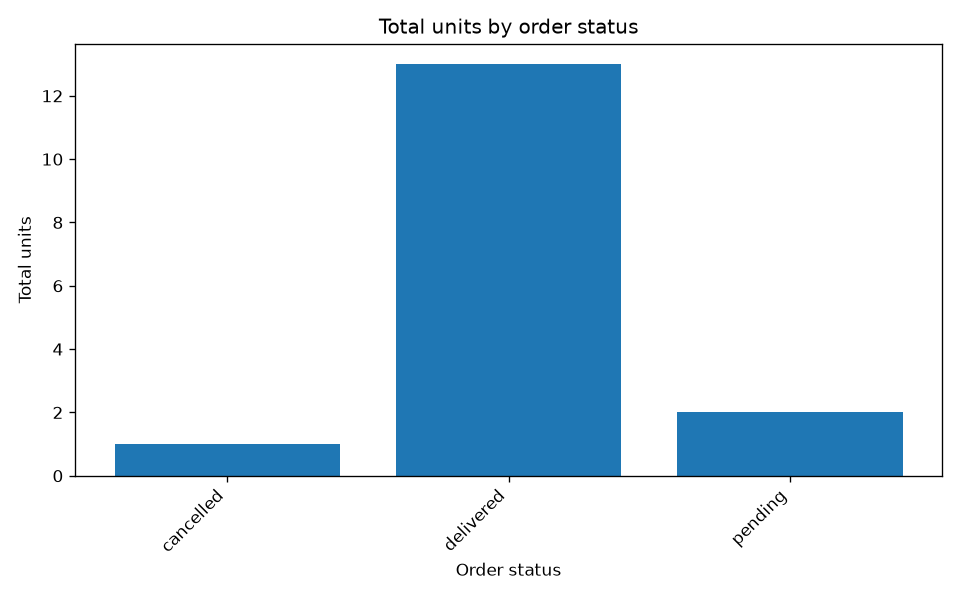
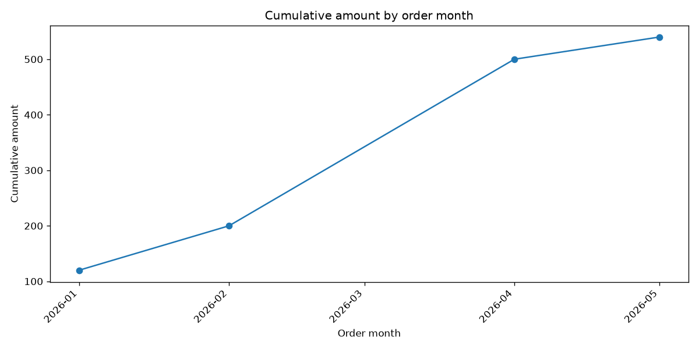
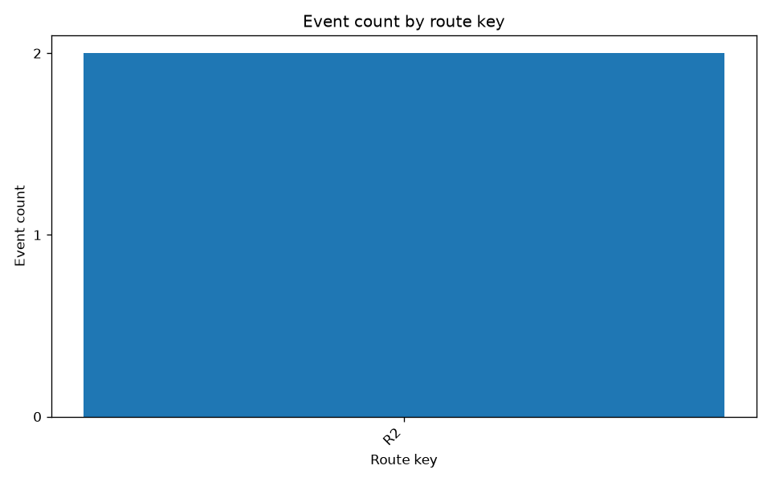

# Stop-code and connection-handling follow-up

**5 November 2026.** Local validation through the user-confirmed free-only Groq organisation, model `openai/gpt-oss-20b`. Original benchmark results are unchanged.

- **4/4 affected regressions passed:** transit t15 and holdout h12/h15/h16; both affected chart cases passed.
- **8/8 newly authored identifier/name cases passed**, including a code/name collision, an explicit numeric display name, an unknown code with a valid empty result and a filtered bar chart.
- **Controlled connection recovery passed:** one intentionally injected pre-network connection failure, followed by one application retry and successful real Groq SQL/answer calls. This is not a naturally observed outage.
- **3/3 chart checks passed**, and all three resulting PNGs were visually inspected.
- **314 offline tests passed**, with lint, dependency and Compose configuration checks passing.

## Stop-code correction

The original t15 result incorrectly filtered stop_name=S4 and returned nothing after three SQL attempts. The corrected request filters stop_key=S4, returns R2 and succeeds on the first generated-SQL attempt. The fresh fixture makes S4 the key of one stop and the name of another; explicit code and name requests still select the correct columns. Platform 12 remains a display name, and unknown S99 stays an empty exact lookup without broadening.

Grounding uses bounded parameterised primary-key probes and includes only confirmed supplied identifiers in schema context. It does not rewrite SQL or guarantee correctness on arbitrary schemas. The stop/top substring issue is fixed with whole-word intent matching.

## Connection recovery

At most two extra connection/timeout attempts are shared across one question, with one- and two-second backoff. SDK retries are disabled to avoid stacking. HTTP errors (including 401/402/403/429 and server errors) do not retry or trigger an alternate provider. Free-tier rejection still stops evaluation. Exhausted connection failures return a sanitised 503 and Retry-After: 5, with a correlation ID.

Failed-attempt counters and partial usage survive failures; missing token usage is not treated as zero. The controlled test records one failed attempt, one retry and two successful model calls. Its usage flag is conservatively incomplete, so it has no full cost estimate. The earlier three connection failures remain in the original five-run report; this small follow-up does not establish a new five-run reliability rate.

## Evidence

| Phase | SQL matches | Chart checks | Controlled failure |
| --- | --- | --- | --- |
| transit-regression | 1/1 | 0/0 | False |
| holdout-regressions | 3/3 | 2/2 | False |
| controlled-recovery | 1/1 | 0/0 | True |
| fresh-identifiers | 8/8 | 1/1 | False |

The eight new cases were authored before live execution and run with frozen sources/prompts. They are developer-written synthetic checks, not a blinded external benchmark; they are now exposed regression cases. The local code has not been deployed to Render.

Raw phase outputs are in the matching subfolders. [Manifest and fingerprints](manifest.json) · [Review, baseline checksums and test evidence](review.json).

## Naturally observed recovery

In the non-injected fresh-identifiers phase, i07 encountered one connection/timeout failure and recovered after one application retry. Its exact unknown-code lookup returned the correct empty result, with one generated-SQL execution attempt. This is separate from the controlled experiment. The underlying network cause was not established.

Cost coverage is 11/13: the controlled recovery and the naturally recovered request both conservatively retain token_usage_complete=false. Their missing usage is not filled with zero, and no complete 13-question mean or actual bill is claimed.
