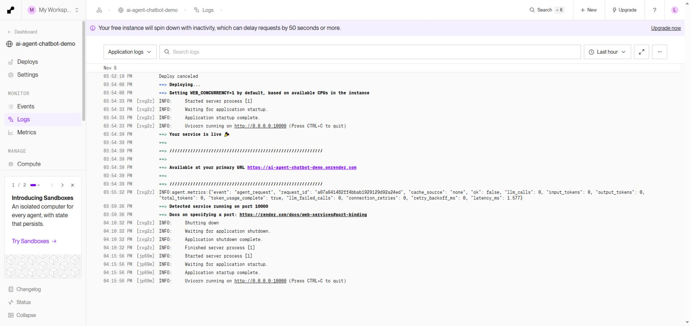

# Fixed-version Render deployment and availability

On 5 November 2026, commit `5df7de9f8f36c4674d136a58087d22c2c77f83a1` reached the existing Docker **Free** service at https://ai-agent-chatbot-demo.onrender.com. No new hosting resource, paid upgrade or credential replacement was used.

## CI and deployment gate

Main [CI run 41973491756](https://github.com/letriluan/AI-Agent-Chatbot/actions/runs/41973491756) passed at **05:23:08 UTC**, including 314 tests, lint, offline evaluations, dependency/Compose validation and a Linux Docker build. Render's Auto-Deploy `dep-dbm15fvb9u1s738a6dag` began at **05:23:11 UTC** and became Live at **05:24:39 UTC** (dashboard duration 1m 27s). The dashboard's service gate was inspected as **After CI Checks Pass**.

A separate Blueprint auto-sync build began before merged-commit CI finished. It was **canceled** (`dep-dbm14ku1egvs73b0j2v0`); Blueprint **Auto Sync was set to No / Sync paused**. Source auto-deploys keep the CI gate. Configuration changes now require a reviewed Manual sync after the exact target commit passes CI. No deliberately failing main commit was introduced. Screenshots and the deployment-evidence JSON retain the observations.

## Hosted smoke checks

Health, database readiness, homepage, deterministic write refusal (zero model calls), blank-input rejection and oversized-input rejection passed. Two subsequent fresh hosted questions passed strict independent SQL-result checks: total orders **99,441**, and counts by order status with a valid chart PNG. They made **five observed model calls** using Render's existing user-confirmed free-only Groq credential. Both cached repeats passed with **zero model calls**, including exact chart-image preservation. The chart was visually inspected; the public API does not expose its separate plot-query rows, so no strict hosted plot-data comparison is claimed. This is a two-question deployment smoke check, not a rerun of all ten public examples or the local synthetic suites.

## One confirmed idle/wake trial

The availability workflow was disabled for a **20-minute controlled no-probe interval**, from **05:25:32.673 UTC**. Render logs show the old instance `rxg2z` shutting down and finishing at **05:40:32 UTC**, approximately 15 minutes after the last controlled request. The wake probe began at **05:45:32.674 UTC**. Its first response was **HTTP 503** after 520.886 ms; that observation is preserved. After one five-second poll interval, the next health request returned the expected JSON.

**Client-observed wake to healthy: 32,851.516 ms (32.85 s).** Render logs show a new instance `jp69m` starting and completing application startup at **05:45:56 UTC**. A subsequent dashboard check confirmed the same Live deployment and commit, with no intervening deploy. This lifecycle evidence supports the cold-start attribution; generic raw HTTP samples deliberately retain `cold_start_confirmed=false`, with confirmation added only in the separate review.

The immediate warm health/readiness pair took **234.478 ms / 198.684 ms**. Timing includes network delay, polling and platform routing, not pure application CPU startup. This is one cold trial, not a latency distribution. Other public traffic was not excluded; actual process shutdown and restart were independently observed. The experiment and all monitoring calls made **zero model calls**.

## Monitoring

The [Demo availability workflow](https://github.com/letriluan/AI-Agent-Chatbot/actions/workflows/availability.yml) was re-enabled after the experiment and its API state verified as **active**. It samples `/health` and `/ready` at minutes **17 and 47** of every hour, requires their expected JSON, uploads observations for 30 days, and needs no provider credentials. Scheduling is best effort; observations are not continuous uptime or an SLA.

The first manually dispatched [run 41976127859](https://github.com/letriluan/AI-Agent-Chatbot/actions/runs/41976127859) succeeded. Its downloaded artifact records healthy/ready in **313.694 / 258.188 ms**, with `model_called=false`. Subsequent scheduled-run evidence is recorded separately as it arrives. Do not infer a long-term availability rate from this initial sample.

The second manually dispatched [run 41979530248](https://github.com/letriluan/AI-Agent-Chatbot/actions/runs/41979530248) also passed, recording **356.239 / 268.463 ms** for health/readiness. These are **two available sample pairs** from **05:46:43 to 06:18:37 UTC** (about 32 minutes), both explicitly `workflow_dispatch`. They do not establish continuous uptime. At this verification, no `schedule` event had appeared. The remote workflow exactly matches the local cron, the repository is an active public non-fork with default branch main, and the workflow state is active; delivery of the first scheduled event remains unverified. [GitHub documents schedule delays and dropped jobs under high load](https://docs.github.com/en/actions/reference/workflows-and-actions/events-that-trigger-workflows#schedule). See `monitoring-history.json` and both preserved artifacts.
