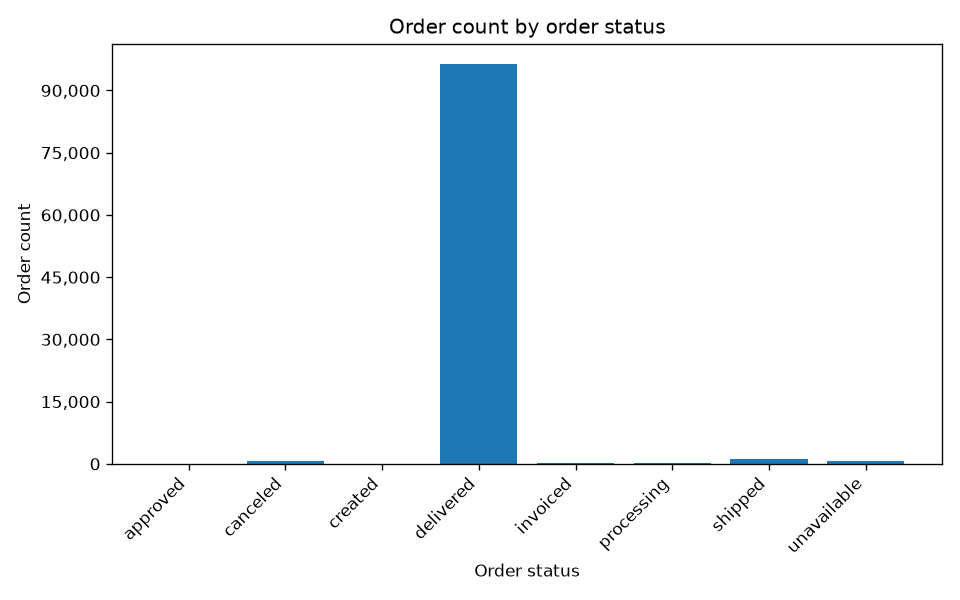
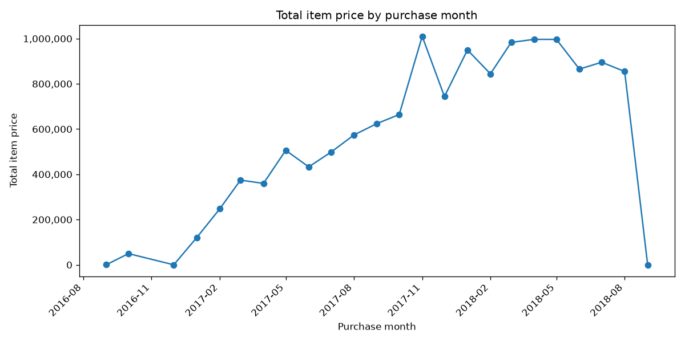
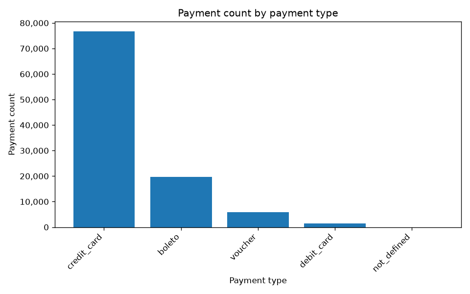

# Render deployment check — 5 November 2026

Completed through the public HTTPS API with the user-confirmed free-only Groq account. No local provider key was used.

- Demo checks: **10/10 passed** (nine SQL-result checks plus one deterministic write refusal).
- The nine data questions were uncached and made **21 observed model calls** in total.
- Returned SQL: **9/9** matched independent queries over the committed Olist CSV data.
- Chart PNGs: **3/3** valid, with all three separately inspected visually.
- Cache checks: **3/3**, with preserved SQL/images and **zero model calls** on each repeat.
- Input validation: **2/2** (blank and overlong questions returned HTTP 422).
- Numeric support: six supported answers and three automatic context flags; manual review found the flags were at least one item and two Top 5 headings, not invented result values.

| Case | Result | HTTP time (s) | Model calls |
| --- | --- | --- | --- |
| orders | Pass | 2.41 | 2 |
| statuses | Pass | 5.85 | 3 |
| delivered_join | Pass | 2.16 | 2 |
| monthly_items | Pass | 9.83 | 3 |
| write_refusal | Pass | 0.28 | 0 |
| customer_states | Pass | 2.42 | 2 |
| delivered_percentage | Pass | 3.86 | 2 |
| payment_types | Pass | 5.30 | 3 |
| product_categories | Pass | 5.11 | 2 |
| average_price | Pass | 1.88 | 2 |

## Chart inspection

## Scope

This is one run of known Olist demo questions, not the five-run synthetic holdout or the transit evaluation. Public cache reuse cannot establish repeated fresh-model reliability. The public API does not expose the deployed commit, model identity or separate plot-query rows. The local source dataset hashes are recorded; the remote dataset fingerprint is not exposed.

The raw runner output retains automatic chart_visually_reviewed=false because the runner cannot visually inspect. The separate review.json records the subsequent human-readable visual assessment and context-flag review. No automated full narrative factuality score or monetary bill is claimed.

Raw results: [results.json](results.json). Subsequent review and source fingerprints: [review.json](review.json).
