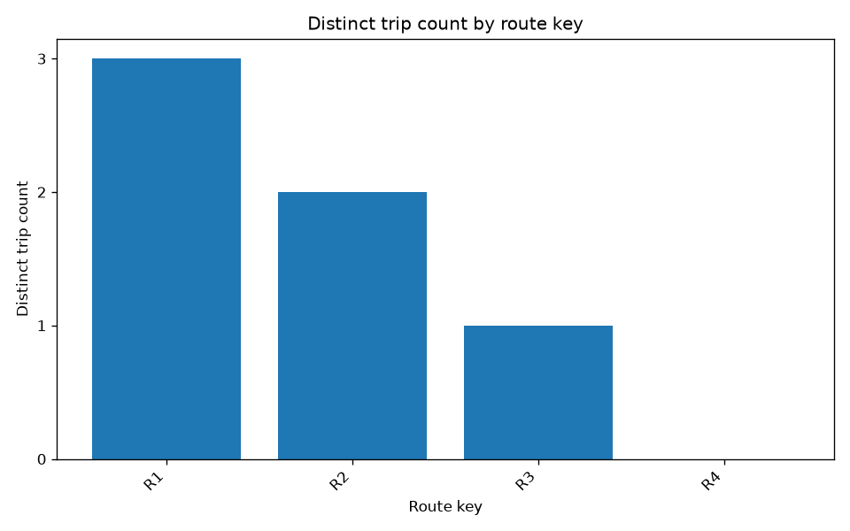
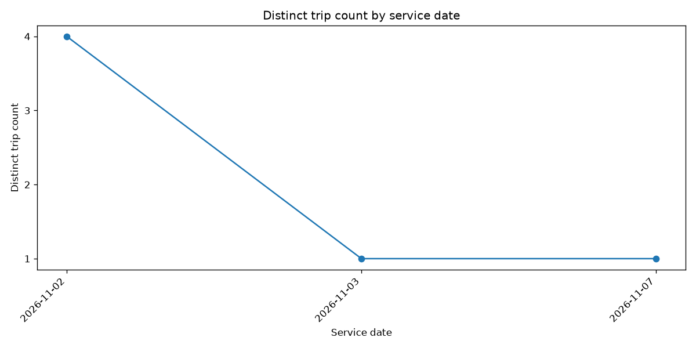
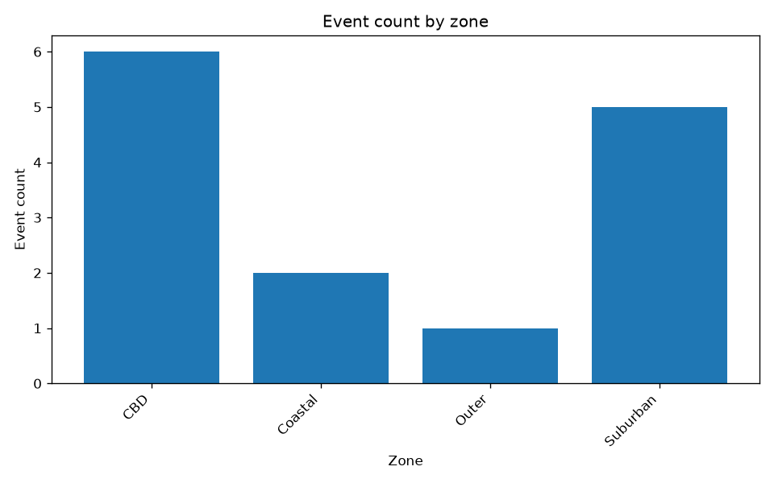
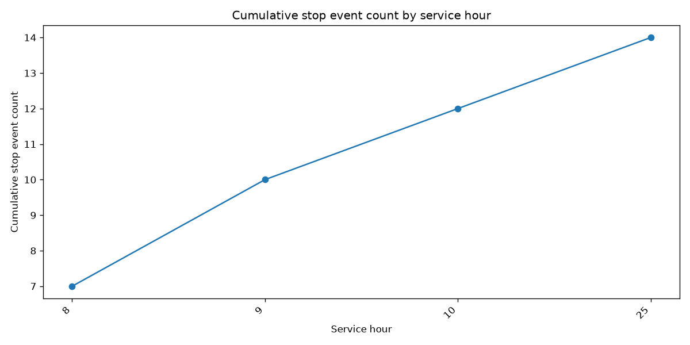

# Synthetic transit: first live evaluation

**5 November 2026**; free-only Groq account, model `openai/gpt-oss-20b`, frozen prompts/implementation and fresh per-question caches.

- Strict SQL execution matches: **23/24 (95.83%)**.
- Chart checks: **4/4** (plot-query results, actual renderer data, chart type/labels, PNG and cached-image reuse). All four PNGs were separately inspected visually.
- Cache checks: **24/24**; provider exceptions: **0**.
- Numeric support: **16 supported, one contextual flag, seven unscored**. This is separate from SQL correctness and complete semantic factuality.
- Recorded tokens: **45,452**. Complete reported usage on all 24 cases.
- Standard-list-price estimate: **USD 0.005974800 total**, **USD 0.000248950 per question**. These are dated estimates, not measured charges; execution was authorised for the free organisation only.

## Observed failure

`t15` asked for distinct route keys serving stop `S4`. The generated query filtered `dim_stop.stop_name = 'S4'` instead of `stop_key = 'S4'`. After three attempts it returned no rows; the independent reference returns `R2`. The failed SQL/answer is preserved. Neither the prompts nor case wording were changed during measurement.

The one automatic numeric flag (`t09`) repeats the question threshold `24:00`; the returned `T6` is correct. `t15` illustrates the limit of numeric support: an incorrect empty answer may contain no numeric claims.

## Scope and chart review

This is a small, developer-written synthetic schema, not real Adelaide Metro data, a full GTFS pipeline or proof of general cross-domain accuracy. The questions are now exposed regression cases; future prompt changes need a fresh evaluation set.

The service-date and service-hour line charts use equally spaced observed categories. Their x-axis spacing is not proportional to elapsed time. Their actual category/value arrays were checked against the independent reference.

| Case | SQL | Chart | Numeric support |
| --- | --- | --- | --- |
| t01 | Pass | - | supported |
| t02 | Pass | - | supported |
| t03 | Pass | - | supported |
| t04 | Pass | - | no_numeric_claims |
| t05 | Pass | - | supported |
| t06 | Pass | - | supported |
| t07 | Pass | - | no_numeric_claims |
| t08 | Pass | - | no_numeric_claims |
| t09 | Pass | - | unsupported |
| t10 | Pass | - | supported |
| t11 | Pass | - | supported |
| t12 | Pass | - | supported |
| t13 | Pass | - | supported |
| t14 | Pass | - | supported |
| t15 | Fail | - | no_numeric_claims |
| t16 | Pass | - | no_numeric_claims |
| t17 | Pass | - | supported |
| t18 | Pass | - | no_numeric_claims |
| t19 | Pass | - | no_numeric_claims |
| t20 | Pass | - | supported |
| t21 | Pass | True | supported |
| t22 | Pass | True | supported |
| t23 | Pass | True | supported |
| t24 | Pass | True | supported |

Raw evidence: [results.json](results.json). Subsequent visual/flag review and cost summary: [review.json](review.json).
